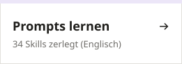

<div align="center">

# pstack für Einsteiger

[English](./README.en.md) · [中文](./README.md) · [日本語](./README.ja.md) · [한국어](./README.ko.md) · [Español](./README.es.md) · [Português](./README.pt.md) · [Français](./README.fr.md) · **Deutsch** · [Русский](./README.ru.md) · [العربية](./README.ar.md)

### Die KI sagt „behoben“. Du öffnest es. Immer noch kaputt.

[pstack](https://github.com/backnotprop/pstack) bringt sie dazu, ihre Arbeit selbst auszuprobieren, bevor sie „fertig“ sagt.<br>Diese Anleitung erklärt pstack in einfachen Worten. Du kannst es lernen, auch wenn du noch nie Code geschrieben hast.

<a href="https://pstack.xiaoxiaodong.ai/de/start/1-why/"><picture><source media="(prefers-color-scheme: dark)" srcset="assets/doors/de-1-dark.svg"></picture></a> <a href="https://pstack.xiaoxiaodong.ai/en/guide/0-what/"><picture><source media="(prefers-color-scheme: dark)" srcset="assets/doors/de-2-dark.svg"></picture></a> <a href="https://pstack.xiaoxiaodong.ai/en/skills/"><picture><source media="(prefers-color-scheme: dark)" srcset="assets/doors/de-3-dark.svg"></picture></a>

<sub>Kostenlos · Open Source · 10 Sprachen</sub>


</div>

<p align="center">
  
</p>

<p align="center">
  <a href="#-warum-du-es-brauchst">Warum</a> ·
  <a href="#-pstack-ist-stark-aber-allein-schwer-zu-lernen">Der Haken</a> ·
  <a href="#-so-hilft-dir-diese-anleitung">Highlights</a> ·
  <a href="#-so-arbeitet-es">So arbeitet es</a> ·
  <a href="#-in-drei-minuten-loslegen">Loslegen</a> ·
  <a href="#️-34-skills-auf-einer-karte">Skill-Karte</a> ·
  <a href="#-in-echten-projekten">Echte Projekte</a> ·
  <a href="#-über-nacht-arbeiten-lassen">Über Nacht</a> ·
  <a href="#-lokal-starten">Lokal starten</a> ·
  <a href="https://pstack.xiaoxiaodong.ai/de/">Online lesen</a>
</p>

## 😵 Warum du es brauchst

Wer schon mit KI programmiert hat, kennt das wahrscheinlich:

- Sie sagt: „Behoben, sollte jetzt passen.“ Du führst es aus. Immer noch kaputt.
- Du sagst: „Geht immer noch nicht.“ Sie entschuldigt sich und ändert etwas anderes. Fünf Runden später ist dein Nachmittag weg.
- Du wolltest einen Button ändern. Sie hat ein Dutzend Dateien angefasst.
- In einem neuen Chat tappt sie in dieselbe Falle wie gestern.

<p align="center">
  
</p>

Das Modell ist nicht zu dumm. Es arbeitet nur ohne Methode: Es ändert Code, den es nicht verstanden hat, und meldet „fertig“, ohne es auszuprobieren. pstack ist das Paket an Agent Skills, das poteto (Mitglied des React-Kernteams, arbeitet bei Cursor) jeden Tag beim eigenen Programmieren nutzt. **Das Modell bleibt dasselbe. Was sich ändert, sind die Reihenfolge der Arbeit und der Anspruch daran:**

| Wann | Typische KI | Mit pstack |
|:---|:---|:---|
| Bevor Code angefasst wird | Ändert direkt | Formuliert das Ziel in eigenen Worten und liest den Code zuerst mit `/how` |
| Einen Bug beheben | Fügt an der Oberfläche eine Prüfung ein | Lässt den Bug erst noch einmal auftreten, findet **die erste Stelle, an der es schiefgeht**, und behebt dann |
| „Fertig“ sagen | „Sollte jetzt passen“ | Fügt echte Befehlsausgaben, gespeicherte Werte und Vorher-nachher-Vergleiche ein |
| Codemenge | Wird immer mehr | Löscht, was geht, und löst es mit der kleinsten Änderung |
| Derselbe Fehler | Passiert beim nächsten Mal wieder | `/correct` ändert das Repo selbst, damit die nächste KI ihn nicht machen kann |
| Paralleles Arbeiten | Mehrere KIs streiten sich um einen Ordner | Jede bekommt ihren eigenen Worktree, so laufen mehrere gefahrlos gleichzeitig |

> [!NOTE]
> pstack schickt mehr Helfer-KIs los und lässt mehrere Modelle an der Arbeit der anderen herumkritteln, deshalb ist es **langsamer und verbraucht mehr Tokens**. Für kleine Änderungen brauchst du es nicht. Wie man spart, steht unter [Kosten im Griff](https://pstack.xiaoxiaodong.ai/en/howto/cost/) (auf Englisch).

## 🧗 pstack ist stark, aber allein schwer zu lernen

poteto hat pstack für den eigenen Gebrauch geschrieben. Die offizielle Doku setzt voraus, dass du schon Senior-Entwickler bist:

- **Eine Wand aus Namen am ersten Tag**: 34 Skills, 23 Playbooks, 24 Prinzipien, alles Fachjargon. Welche davon brauchst du wirklich?
- **Kein klarer erster Schritt**: Welche Version installierst du? Musst du etwas konfigurieren? Welchen Befehl tippst du ein?
- **Den Befehl zu kennen reicht nicht**: Wenn dein Prompt nicht sagt, was „fertig“ heißt, driftet die KI trotzdem ab. Nur eben gründlicher.
- **Antworten, mit denen du nichts anfangen kannst**: lang und technisch. Du siehst nicht, welche Zeile zählt und welche du überspringen kannst.

Viele installieren es, probieren es einmal aus, denken „so viel anders ist das auch nicht“ und geben auf.

## ✨ So hilft dir diese Anleitung

- **In 20 Minuten von null zur ersten Nutzung**: drei Einsteigerlektionen, ein Weg. Bei jedem Schritt steht, was du sehen solltest und was zu tun ist, wenn nicht.
- **Nur lernen, was du brauchst**: ein Befehl, `/poteto-mode`, plus eine Nachricht in drei Teilen: **Was ich will · So sieht „fertig“ aus · Was du mir am Ende zeigst**. Alles andere ist als „bei Bedarf nachschlagen“ markiert.
- **Für jede Lage ein Prompt zum Kopieren**: Bug beheben, Feature hinzufügen, refaktorieren, fremden Code übernehmen, Arbeit vor dem Schlafengehen übergeben. Die Teile in spitzen Klammern austauschen, abschicken.
- **Ihre Antworten lesen lernen**: wo du ihre Zusammenfassung des Auftrags, ihre To-do-Liste und ihre Prüfungen findest, woran du erkennst, ob sie gut gearbeitet hat, und welchen einen Satz du schickst, wenn sie abdriftet.
- **Prompts schreiben lernen vom Profi**: Lies den vollen Text aller 34 Skills, bei jedem mit ein paar zerlegten Sätzen: was die Zeile bei der KI bewirkt, warum sie so formuliert ist und wie du sie übernimmst.
- **Einfache Worte**: Jede Seite beginnt mit einem Satz dazu, wobei sie dir hilft, und unbekannte Begriffe erklären sich beim Darüberfahren.
- **Weltweit lesbar**: Startseite und Einsteigerlektionen gibt es in 10 Sprachen, du kannst also in deiner eigenen anfangen.
- **Auf dem aktuellen Stand**: geprüft mit der aktuellen pstack-Version; jeder Befehl stimmt mit dem offiziellen Repo überein.

## 🧭 So arbeitet es

<p align="center">
  
</p>

Du musst dir nur einen Befehl merken, `/poteto-mode`, und klar sagen, **was du willst** und **was als fertig gilt**. Es wählt eines von 23 „Playbooks“ (Bug beheben, Feature hinzufügen, refaktorieren, Performance untersuchen ...), überträgt die Schritte in eine To-do-Liste und ruft Schritt für Schritt die anderen Skills auf. Schritte, die es auslassen will, verschwinden nicht stillschweigend, sondern werden mit `skip: Grund` markiert.

## ⚡ In drei Minuten loslegen

**1. Installieren** (wähle die Variante für dein Tool)

```bash
# Claude Code (Befehle bekommen das Präfix pstack:, z. B. /pstack:poteto-mode)
/plugin marketplace add cursor/plugins
/plugin install pstack@cursor-plugins

# Cursor
/add-plugin pstack

# Codex, OpenCode und andere (Node.js 22.20+; mit -g global installieren)
npx skills add backnotprop/pstack
```

**2. Modelle wählen**: Führe in einer neuen Unterhaltung einmal `/setup-pstack` aus. Wenn es fragt, ob ein „Verifikations-Skill“ erstellt werden soll, antworte mit **ja**. In Claude Code zeigen [drei empfohlene Setups](https://pstack.xiaoxiaodong.ai/en/howto/claude-code/#how-to-set-it-up-well), wie du Sitzungsmodell und Rollen kombinierst.

**3. Deine erste Aufgabe**: Nimm etwas Echtes, aber nicht Großes, und erkläre es so, wie du einem Kollegen Arbeit übergeben würdest:

```text
/poteto-mode Nach einem Neuladen erscheinen Favoriten manchmal doppelt. Reproduziere es zuerst; ändere noch keinen Code.
Fertig heißt: Nach zehn Klicks hintereinander auf Favorit enthalten die Liste und chrome.storage jeweils genau einen Eintrag.
Zeig mir den tatsächlichen Inhalt von storage vor und nach dem Fix.
```

> [!TIP]
> Ein guter Prompt enthält höchstens fünf Dinge: **das Ziel**, **was als fertig gilt**, **welche Belege du sehen willst**, **was du schon weißt** und **was nicht angefasst werden darf**. Zwei Dinge lässt du besser weg: wie genau es zu tun ist, und deine Vermutung zur Ursache. Mehr dazu in [Schritt 3](https://pstack.xiaoxiaodong.ai/en/guide/3-first-task/) (auf Englisch).

## 🗺️ 34 Skills auf einer Karte

<p align="center">
  
</p>

Im Alltag tippst du nur `/poteto-mode`; die anderen ruft es selbst auf, wenn es sie braucht. Wenn du einen Skill gezielt beim Namen aufrufen oder einen Namen nachschlagen willst, den die KI erwähnt hat, schau in die [Skill-Referenz](https://pstack.xiaoxiaodong.ai/en/skills/) (auf Englisch): Zu jedem Skill gibt es eine Erklärung in einfachen Worten, wann man ihn nutzt, ein Beispiel zum Kopieren und was man dazu installieren sollte. Öffne einen Skill, um seine vollständige SKILL.md und „Was seine Formulierung lehrt“ zu lesen: ein paar Sätze aus dem Original, was jeder davon bei der KI bewirkt, warum er so geschrieben ist und wie du ihn für deine eigenen Prompts übernimmst.

## 🛠 In echten Projekten

Jede Anleitung enthält Prompts, die du direkt kopieren kannst, mit Beispielen aus echten Szenarien wie einer Chrome-Erweiterung, einer Astro-Website oder einer Mitgliederseite auf Cloudflare.

| Deine Aufgabe | Lies das | Der Kern in einem Satz |
|:---|:---|:---|
| Einen Bug beheben | [Reproduzieren, beheben, beweisen](https://pstack.xiaoxiaodong.ai/en/howto/fix-bug/) | Den Bug erst wieder auslösen, bevor irgendetwas behoben wird |
| Ein Feature hinzufügen | [Ohne Altes kaputt zu machen](https://pstack.xiaoxiaodong.ai/en/howto/add-feature/) | Sag, welches bestehende Verhalten sich überhaupt nicht ändern darf |
| Refaktorieren | [Neue Struktur, gleiches Verhalten](https://pstack.xiaoxiaodong.ai/en/howto/refactor/) | Erst die aktuelle Ausgabe festhalten, danach beweisen, dass sie gleich blieb |
| Es ist zu langsam | [Schneller machen, mit Zahlen](https://pstack.xiaoxiaodong.ai/en/howto/perf/) | Gib ihm einen Messwert, kein Gefühl |
| Ein fremdes Projekt übernehmen | [Erst verstehen, dann anfassen](https://pstack.xiaoxiaodong.ai/en/howto/new-codebase/) | „Ändere noch keinen Code“ beschränkt es aufs Untersuchen |
| Unsicher vor dem Einreichen | [Mehrere Modelle nach Schwächen suchen lassen](https://pstack.xiaoxiaodong.ai/en/howto/review-branch/) | Nur Probleme behalten, die sich als echter Fehlschlag zeigen lassen |
| Doku schreiben | [READMEs, PR-Beschreibungen](https://pstack.xiaoxiaodong.ai/en/howto/write-docs/) | Bei Code, den andere nutzen, zuerst die README schreiben |
| Eine große Migration | [Vor dem Schlafengehen übergeben](https://pstack.xiaoxiaodong.ai/en/howto/big-migration/) | Eine Fertig-Bedingung, die besteht oder scheitert, nicht „Arbeite 4 Stunden“ |

Außerdem gibt es [Prompts zum Kopieren](https://pstack.xiaoxiaodong.ai/en/howto/recipes/), [Mit einem Satz zurück auf Kurs](https://pstack.xiaoxiaodong.ai/en/howto/steer/) und [Welcher Skill passt?](https://pstack.xiaoxiaodong.ai/en/howto/which-skill/) (alles auf Englisch).

## 🌙 Über Nacht arbeiten lassen

<p align="center">
  
</p>

Hier zahlen sich alle vorherigen Schritte aus: Nur eine KI, die **ihre eigene Arbeit verifizieren kann**, kannst du beruhigt allein arbeiten lassen. Gib ihr vor dem Schlafengehen einen „Vertrag“: das Ziel, eine Fertig-Bedingung, die eindeutig erfüllt ist oder nicht, einen frischen Worktree, ein Entscheidungslog und einen Notausgang für den Fall, dass sie feststeckt. Lies morgens zuerst den Teil „needs attention“ in der Antwort von `/show-me-your-work`. Du prüfst Entscheidungen, statt die ganze Nacht nachzulesen. Mehr dazu in [Schritt 7](https://pstack.xiaoxiaodong.ai/en/guide/7-overnight/) (auf Englisch).

## 📚 Was es auf der Website gibt

- **[Einsteigerkurs](https://pstack.xiaoxiaodong.ai/de/start/1-why/)**: 3 Lektionen, 20 Minuten, ohne Programmieren · was es dir bringt → installieren → zum ersten Mal benutzen
- **[Ganzer Leitfaden](https://pstack.xiaoxiaodong.ai/en/guide/0-what/)**: 9 Schritte für alle, die programmieren · was es ist → Installation → Modelle wählen → erste Aufgabe → erst verstehen → entwerfen, bauen, aufräumen → verifizieren und ausliefern → über Nacht → sobald du dich auskennst
- **[Skill-Referenz](https://pstack.xiaoxiaodong.ai/en/skills/)**: 34 Skills, jeweils mit vollem Text und einer Analyse der Formulierung
- **[How-to](https://pstack.xiaoxiaodong.ai/en/howto/)**: 17 Anleitungen, je eine Aufgabe
- **[Wiki](https://pstack.xiaoxiaodong.ai/en/wiki/)**: 20 Begriffe · ein Satz → ein Vergleich → in pstack → häufige Irrtümer; mit Tabellen der 24 Prinzipien und 23 Playbooks
- **[FAQ](https://pstack.xiaoxiaodong.ai/en/faq/)**: Kostet das Geld? Muss ich Cursor nutzen? Pfuscht es mir im Code herum?
- **Sprachen**: Startseite und Einsteigerlektionen · 10 Sprachen. Ganzer Leitfaden, Skills, How-tos, Wiki und FAQ · English und 中文

Mit <kbd>⌘</kbd> <kbd>K</kbd> oben rechts auf jeder Seite durchsuchst du die ganze Website. Im Text markieren **Textmarker** und **dicke Unterstreichung** das Wichtigste, und gepunktet unterstrichene Begriffe zeigen beim Darüberfahren eine Erklärung in einem Satz.

## 🧑‍💻 Lokal starten

```bash
npm install
npm run dev        # http://localhost:4420
npm run build      # Ausgabe nach dist/
npm run release    # bauen und auf Cloudflare deployen
```

```text
src/data/nav.js        Website-Struktur: Leitfaden, How-to-Liste, Glossar (einzige Quelle)
src/data/skills.js     Daten der Skill-Referenz
src/data/wiki.js       Wiki-Einträge
src/data/faq.js        FAQ
src/pages/start/       Einsteigerkurs, 3 Lektionen (MDX)
src/pages/guide/       Leitfaden (MDX)
src/pages/howto/       How-to (MDX)
public/xxd/            Xiaoxiaodong UI Kit (eigene Kopie, kein CDN)
tools/build_assets.py  Erzeugt README-Illustrationen, SVG-Animationen und das Vorschaubild (social.svg → social.png / public/og.png)
```

Inhalte bearbeiten, Seiten hinzufügen und Schreibregeln: siehe [docs/MAINTAINING.md](docs/MAINTAINING.md) (auf Chinesisch). Alle Bilder in der README werden mit `python3 tools/build_assets.py` erzeugt; nach Änderungen an Text oder Farben einfach erneut ausführen.

## 🙌 Danksagung

- [pstack](https://github.com/cursor/plugins/tree/main/pstack) stammt von [poteto](https://x.com/poteto); diese Website nutzt [backnotprop/pstack](https://github.com/backnotprop/pstack), einen allgemeinen Mirror. Der Leitfaden basiert auf dessen README und docs/guide; für Befehle und Verhalten gilt das offizielle Repository.
- Das Gerüst der Website stammt von der [Xiaoxiaodong-VPS-Tutorial-Website](https://vps.xiaoxiaodong.ai), die Oberfläche nutzt das [Xiaoxiaodong UI Kit](https://ui.xiaoxiaodong.ai), und die Farben der Illustrationen sind von [ghostty-tint](https://github.com/nevertoday/ghostty-tint) entliehen.

Dies ist eine inoffizielle Einsteigeranleitung. Wenn etwas unklar ist oder die Schritte nicht funktionieren, [eröffne bitte ein Issue](https://github.com/nevertoday/xxd-pstack/issues).

## 📄 Lizenz

Tutorial-Texte und Website-Code stehen unter [MIT](LICENSE). Der Build des Xiaoxiaodong UI Kit in `public/xxd/` ist davon ausgenommen und hat eine eigene [LICENSE](public/xxd/LICENSE) (kostenlos für nichtkommerzielle Nutzung, kommerzielle Nutzung erfordert eine Lizenz).

Copyright (c) 2026 [小小东 Xiaoxiaodong](https://x.com/xiaoxiaodong01)
