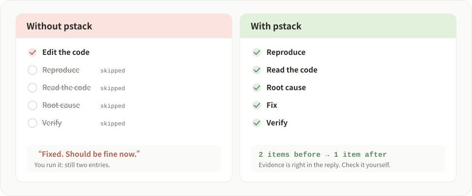
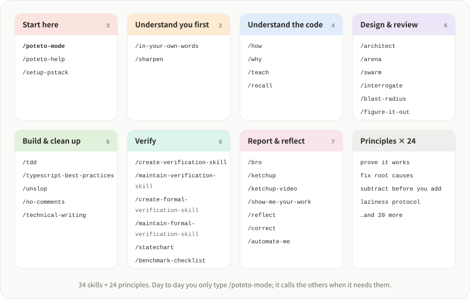
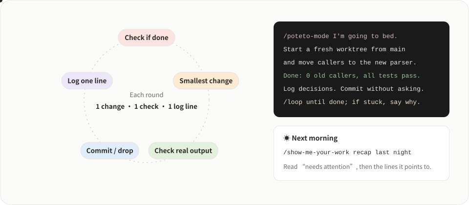

<div align="center">

# Guía de pstack para principiantes

[中文](./README.md) · [English](./README.en.md) · [한국어](./README.ko.md) · [日本語](./README.ja.md) · [العربية](./README.ar.md) · **Español** · [Français](./README.fr.md) · [Русский](./README.ru.md) · [Deutsch](./README.de.md) · [Português](./README.pt.md)

**Haz que la IA escriba código como un ingeniero sénior de confianza: primero entiende, luego cambia y después muestra las pruebas.**

Una guía para principiantes de [pstack](https://github.com/backnotprop/pstack), en lenguaje llano: desde el primer comando de instalación hasta dejarlo trabajando toda la noche en un proyecto real.

### 👉 [Leer en línea: pstack.xiaoxiaodong.ai/en](https://pstack.xiaoxiaodong.ai/en/)

El sitio del tutorial está disponible en inglés y en chino (versión china: <https://pstack.xiaoxiaodong.ai>).


</div>

<p align="center">
  
</p>

<p align="center">
  <a href="#-por-qué-lo-necesitas">Por qué</a> ·
  <a href="#-cómo-trabaja">Cómo trabaja</a> ·
  <a href="#-empieza-en-tres-minutos">Primeros pasos</a> ·
  <a href="#️-34-skills-en-un-mapa">Mapa de skills</a> ·
  <a href="#-en-proyectos-reales">Proyectos reales</a> ·
  <a href="#-déjalo-trabajar-toda-la-noche">Toda la noche</a> ·
  <a href="#-ejecutarlo-en-local">En local</a> ·
  <a href="https://pstack.xiaoxiaodong.ai/en/">Leer en línea</a>
</p>

## 😵 Por qué lo necesitas

Si has programado con IA, seguramente has visto esto: se pone a editar de inmediato, cambia algo en un sitio que parece razonable y luego te dice «Arreglado, ya debería funcionar». Lo ejecutas y sigue roto.

<p align="center">
  
</p>

pstack es el paquete de Agent Skills que poteto (miembro del equipo central de React, trabaja en Cursor) usa a diario para escribir código. **El modelo es el mismo. Lo que cambia es el orden en que trabaja y el nivel que se exige:**

| | La IA de siempre | Con pstack |
|---|---|---|
| Antes de tocar código | Edita directamente | Reformula el objetivo con sus propias palabras y primero lee el código con `/how` |
| Arreglar un bug | Añade una comprobación en la superficie | Primero lo reproduce, encuentra **el primer punto donde falla** y luego lo arregla |
| Al decir «listo» | «Ya debería funcionar» | Pega la salida real de los comandos, los valores guardados y comparaciones de antes y después |
| Cantidad de código | Cada vez más | Primer principio: borra lo que puedas y resuélvelo con el cambio más pequeño |
| Trabajo en paralelo | Varias IA se pelean por la misma carpeta | Cada una usa su propio worktree, así puedes lanzar varias a la vez sin miedo |

> [!NOTE]
> pstack lanza más subagentes y hace que varios modelos busquen fallos en el trabajo de los otros, así que es **más lento y gasta más tokens**. Es el precio del rigor. No lo uses para cambios pequeños. Para ahorrar, consulta [Reducir costes](https://pstack.xiaoxiaodong.ai/en/howto/cost/) (en inglés).

## 🧭 Cómo trabaja

<p align="center">
  
</p>

Solo tienes que recordar un comando, `/poteto-mode`, y decir con claridad **qué quieres** y **qué cuenta como terminado**. Elige uno de sus 23 «playbooks» (arreglar un bug, añadir una función, refactorizar, investigar el rendimiento...), copia los pasos en una lista de tareas y llama a las demás skills paso a paso. Los pasos que decide saltarse no desaparecen en silencio: quedan marcados como `skip: motivo`.

## ⚡ Empieza en tres minutos

**1. Instala** (elige la opción de tu herramienta)

```bash
# Claude Code (los comandos llevan el prefijo pstack:, por ejemplo /pstack:poteto-mode)
/plugin marketplace add cursor/plugins
/plugin install pstack@cursor-plugins

# Cursor
/add-plugin pstack

# Codex, OpenCode y otros (Node.js 22.20+; añade -g para instalar globalmente)
npx skills add backnotprop/pstack
```

**2. Elige los modelos**: en una conversación nueva, ejecuta `/setup-pstack` una vez. Cuando pregunte si quieres generar una «skill de verificación», responde **sí**. En Claude Code, mira [tres configuraciones recomendadas](https://pstack.xiaoxiaodong.ai/en/howto/claude-code/#how-to-set-it-up-well) para combinar el modelo de la sesión con cada rol.

**3. Tu primera tarea**: elige algo real pero no muy grande y explícalo como si le pasaras el trabajo a un compañero:

```text
/poteto-mode A veces los favoritos aparecen duplicados después de recargar. Reprodúcelo primero; no cambies código todavía.
Terminado significa: tras pulsar Favorito diez veces seguidas, la lista y chrome.storage tienen exactamente una entrada cada una.
Muéstrame el contenido real de storage antes y después del arreglo.
```

> [!TIP]
> Un buen prompt tiene como mucho cinco cosas: **el objetivo**, **qué cuenta como terminado**, **qué pruebas quieres**, **lo que ya sabes** y **las restricciones reales**. Hay dos cosas que es mejor no poner: cómo hacerlo exactamente y tu sospecha sobre la causa. Más en el [Paso 3](https://pstack.xiaoxiaodong.ai/en/guide/3-first-task/) (en inglés).

## 🗺️ 34 skills en un mapa

<p align="center">
  
</p>

En el día a día solo escribes `/poteto-mode`; él llama a las demás cuando las necesita. Si quieres usar una por su nombre, o la IA menciona un nombre que quieres consultar, ve a la [Referencia de skills](https://pstack.xiaoxiaodong.ai/en/skills/) (en inglés): cada skill tiene un resumen en lenguaje llano, cuándo usarla, un ejemplo para copiar y con qué otras instalarla.

## 🛠 En proyectos reales

Cada guía trae prompts que puedes copiar tal cual, con ejemplos de casos reales como una extensión de Chrome, un sitio con Astro o un sitio de miembros en Cloudflare.

| Lo que tienes entre manos | Lee esto | La idea clave |
|---|---|---|
| Arreglar un bug | [Reproducir, arreglar, demostrar](https://pstack.xiaoxiaodong.ai/en/howto/fix-bug/) | «Reprodúcelo primero» es una restricción, no una cortesía |
| Añadir una función | [Sin romper lo que ya hay](https://pstack.xiaoxiaodong.ai/en/howto/add-feature/) | Di qué comportamiento existente no puede cambiar ni un byte |
| Refactorizar | [Nueva estructura, mismo comportamiento](https://pstack.xiaoxiaodong.ai/en/howto/refactor/) | Graba la salida actual primero y luego demuestra que no cambió |
| Va demasiado lento | [Hazlo más rápido, con números](https://pstack.xiaoxiaodong.ai/en/howto/perf/) | Dale una medición, no una sensación |
| Heredar un proyecto desconocido | [Entender antes de tocar](https://pstack.xiaoxiaodong.ai/en/howto/new-codebase/) | «No cambies código todavía» lo limita a investigar |
| Dudas antes de entregar | [Que varios modelos busquen fallos](https://pstack.xiaoxiaodong.ai/en/howto/review-branch/) | Quédate solo con los problemas que se pueden demostrar fallando |
| Escribir documentación | [READMEs, descripciones de PR](https://pstack.xiaoxiaodong.ai/en/howto/write-docs/) | Para código que usarán otros, escribe primero el README |
| Una migración grande | [Déjasela antes de dormir](https://pstack.xiaoxiaodong.ai/en/howto/big-migration/) | «Trabaja 4 horas» no es una condición de terminado |

También hay [Prompts para copiar y pegar](https://pstack.xiaoxiaodong.ai/en/howto/recipes/), [Volver al buen camino con una frase](https://pstack.xiaoxiaodong.ai/en/howto/steer/) y [No sé qué skill usar](https://pstack.xiaoxiaodong.ai/en/howto/which-skill/) (todo en inglés).

## 🌙 Déjalo trabajar toda la noche

<p align="center">
  
</p>

Aquí es donde todos los pasos anteriores dan fruto: solo una IA que **puede verificar su propio trabajo** es una IA que puedes dejar trabajando sola con tranquilidad. Antes de dormir, dale un «contrato»: el objetivo, una condición de terminado que se cumpla o no sin ambigüedad, un worktree nuevo, un registro de decisiones y una salida de emergencia por si se atasca. Por la mañana, lee primero la parte «needs attention» de la respuesta de `/show-me-your-work`. Revisas decisiones en lugar de releer toda la noche. Más en el [Paso 7](https://pstack.xiaoxiaodong.ai/en/guide/7-overnight/) (en inglés).

## 📚 Qué hay en el sitio

| Sección | Contenido |
|---|---|
| [Guía](https://pstack.xiaoxiaodong.ai/en/guide/0-what/) | 9 pasos, en orden: qué es → instalar → elegir modelos → primera tarea → entender primero → diseñar, construir, limpiar → verificar y entregar → toda la noche → hacerlo tuyo |
| [Referencia de skills](https://pstack.xiaoxiaodong.ai/en/skills/) | 34 skills, una ficha cada una |
| [How-to](https://pstack.xiaoxiaodong.ai/en/howto/) | 17 guías, una tarea cada una |
| [Wiki](https://pstack.xiaoxiaodong.ai/en/wiki/) | 20 conceptos: una frase → una analogía → en pstack → errores comunes; incluye tablas de los 24 principios y los 23 playbooks |
| [Preguntas frecuentes](https://pstack.xiaoxiaodong.ai/en/faq/) | ¿Cuesta dinero? ¿Tengo que usar Cursor? ¿Me va a estropear el código? |

Pulsa <kbd>⌘</kbd> <kbd>K</kbd> arriba a la derecha de cualquier página para buscar en todo el sitio. En el texto, el **marcador** y el **subrayado grueso** señalan lo importante, y los términos con subrayado punteado muestran una explicación de una línea al pasar el ratón.

## 🧑‍💻 Ejecutarlo en local

```bash
npm install
npm run dev        # http://localhost:4420
npm run build      # genera la salida en dist/
npm run release    # compila y despliega en Cloudflare
```

```text
src/data/nav.js        Estructura del sitio: guía, lista de How-to, glosario (fuente única)
src/data/skills.js     Datos de la referencia de skills
src/data/wiki.js       Entradas de la Wiki
src/data/faq.js        Preguntas frecuentes
src/pages/guide/       Guía (MDX)
src/pages/howto/       How-to (MDX)
public/xxd/            Xiaoxiaodong UI Kit (copia incluida, sin CDN)
tools/build_assets.py  Genera las ilustraciones del README, las animaciones SVG y la imagen para compartir (social.svg → social.png / public/og.png)
```

Para editar contenido, añadir páginas y las normas de redacción, consulta [docs/MAINTAINING.md](docs/MAINTAINING.md) (en chino). Todas las imágenes del README se generan con `python3 tools/build_assets.py`; vuelve a ejecutarlo si cambias textos o colores.

## 🙌 Agradecimientos

- [pstack](https://github.com/cursor/plugins/tree/main/pstack) es obra de [poteto](https://x.com/poteto); este sitio usa [backnotprop/pstack](https://github.com/backnotprop/pstack), un mirror de uso general. La guía se basa en su README y en docs/guide; para comandos y comportamiento, manda el repositorio oficial.
- La estructura del sitio viene del [sitio de tutoriales Xiaoxiaodong VPS](https://vps.xiaoxiaodong.ai), la interfaz usa el [Xiaoxiaodong UI Kit](https://ui.xiaoxiaodong.ai) y los colores de las ilustraciones son de [ghostty-tint](https://github.com/nevertoday/ghostty-tint).

Esta es una guía para principiantes no oficial. Si algo no está claro o seguir los pasos no funciona, [abre un issue](https://github.com/nevertoday/xxd-pstack/issues).

## 📄 Licencia

El texto del tutorial y el código del sitio están bajo [MIT](LICENSE). La compilación del Xiaoxiaodong UI Kit en `public/xxd/` no está incluida; tiene su propia [LICENSE](public/xxd/LICENSE) (gratis para uso no comercial; el uso comercial requiere licencia).

Copyright (c) 2026 [小小东 Xiaoxiaodong](https://x.com/xiaoxiaodong01)
