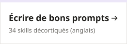

<div align="center">

# Guide pstack pour débutants

[English](./README.en.md) · [中文](./README.md) · [日本語](./README.ja.md) · [한국어](./README.ko.md) · [Español](./README.es.md) · [Português](./README.pt.md) · **Français** · [Deutsch](./README.de.md) · [Русский](./README.ru.md) · [العربية](./README.ar.md)

### L'IA dit « corrigé ». Vous ouvrez. Toujours cassé.

[pstack](https://github.com/backnotprop/pstack) l'oblige à tester son propre travail avant de vous dire que c'est fini.<br>Ce guide explique pstack avec des mots simples. Vous pouvez l'apprendre même si vous n'avez jamais écrit une ligne de code.

<a href="https://pstack.xiaoxiaodong.ai/fr/start/1-why/"><picture><source media="(prefers-color-scheme: dark)" srcset="assets/doors/fr-1-dark.svg"></picture></a> <a href="https://pstack.xiaoxiaodong.ai/en/guide/0-what/"><picture><source media="(prefers-color-scheme: dark)" srcset="assets/doors/fr-2-dark.svg"></picture></a> <a href="https://pstack.xiaoxiaodong.ai/en/skills/"><picture><source media="(prefers-color-scheme: dark)" srcset="assets/doors/fr-3-dark.svg"></picture></a>

<sub>Gratuit · open source · 10 langues</sub>


</div>

<p align="center">
  
</p>

<p align="center">
  <a href="#-pourquoi-en-avez-vous-besoin">Pourquoi</a> ·
  <a href="#-pstack-est-génial-mais-dur-à-apprendre-seul">La difficulté</a> ·
  <a href="#-ce-que-ce-guide-vous-apporte">Points forts</a> ·
  <a href="#-comment-il-travaille">Fonctionnement</a> ·
  <a href="#-démarrer-en-trois-minutes">Démarrer</a> ·
  <a href="#️-34-skills-une-seule-carte">Carte des skills</a> ·
  <a href="#-dans-de-vrais-projets">Projets réels</a> ·
  <a href="#-le-laisser-travailler-toute-la-nuit">Toute la nuit</a> ·
  <a href="#-lancer-en-local">En local</a> ·
  <a href="https://pstack.xiaoxiaodong.ai/fr/">Lire en ligne</a>
</p>

## 😵 Pourquoi en avez-vous besoin

Si vous avez déjà codé avec une IA, vous avez sûrement vécu ça :

- Elle dit « Corrigé, ça devrait aller maintenant ». Vous lancez. Toujours cassé.
- Vous dites « c'est toujours cassé ». Elle s'excuse et change autre chose. Cinq allers-retours plus tard, votre après-midi y est passé.
- Vous lui avez demandé de changer un bouton. Elle a touché une douzaine de fichiers.
- Dans une nouvelle conversation, elle retombe dans le même piège qu'hier.

<p align="center">
  
</p>

Le modèle n'est pas trop bête. Il travaille simplement sans méthode : il modifie du code qu'il n'a pas compris, et dit que c'est fini sans avoir essayé. pstack est le paquet d'Agent Skills que poteto (membre de l'équipe principale de React, qui travaille chez Cursor) utilise chaque jour pour écrire du code. **Le modèle reste le même. Ce qui change, c'est l'ordre dans lequel il travaille et l'exigence qu'il s'impose :**

| Quand | L'IA habituelle | Avec pstack |
|:---|:---|:---|
| Avant de toucher au code | Modifie directement | Reformule l'objectif avec ses propres mots, lit d'abord le code avec `/how` |
| Corriger un bug | Ajoute une vérification en surface | Fait d'abord réapparaître le bug, trouve **le premier endroit où ça déraille**, puis corrige |
| Dire « c'est fait » | « Ça devrait aller maintenant » | Colle la vraie sortie des commandes, les valeurs enregistrées, des comparaisons avant/après |
| Quantité de code | Ne cesse de grossir | Supprime ce qui peut l'être, résout avec le plus petit changement |
| La même erreur | La refait la fois suivante | `/correct` modifie le dépôt lui-même, pour que la prochaine IA ne puisse plus la faire |
| Travail en parallèle | Plusieurs IA se disputent un même dossier | Chacune a son propre worktree, vous pouvez en lancer plusieurs à la fois sans crainte |

> [!NOTE]
> pstack envoie plus d'IA auxiliaires et fait relire le travail des uns par les autres modèles, il est donc **plus lent et consomme plus de tokens**. Ne l'utilisez pas pour les petites modifications. Pour économiser, voir [Maîtriser les coûts](https://pstack.xiaoxiaodong.ai/en/howto/cost/) (en anglais).

## 🧗 pstack est génial, mais dur à apprendre seul

poteto a écrit pstack pour son propre usage. La doc officielle part du principe que vous êtes déjà ingénieur senior :

- **Un mur de noms dès le premier jour** : 34 skills, 23 playbooks, 24 principes, que du jargon. Lesquels vous servent vraiment ?
- **Aucun premier pas évident** : quelle version installer ? Faut-il configurer quelque chose ? Quelle commande taper ?
- **Connaître la commande ne suffit pas** : si votre prompt ne dit pas ce que « terminé » veut dire, l'IA dérape quand même. Elle dérape juste avec plus de soin.
- **Des réponses illisibles** : longues et techniques. Impossible de savoir quelle ligne compte et laquelle on peut sauter.

Beaucoup l'installent, l'essaient une fois, se disent « ça ne change pas grand-chose » et laissent tomber.

## ✨ Ce que ce guide vous apporte

- **De zéro à l'utilisation en 20 minutes** : trois leçons pour débutants, un seul chemin. Chaque étape dit ce que vous devez voir, et quoi faire si ce n'est pas le cas.
- **N'apprenez que l'essentiel** : une commande, `/poteto-mode`, plus un message en trois parties : **Ce que je veux · Le résultat attendu · Ce que tu me montres à la fin**. Tout le reste est marqué « à consulter quand vous en aurez besoin ».
- **Un prompt prêt à copier pour chaque situation** : corriger un bug, ajouter une fonctionnalité, refactoriser, reprendre un code inconnu, passer le relais avant d'aller dormir. Remplacez ce qui est entre chevrons, et envoyez.
- **Apprenez à lire ses réponses** : où trouver sa reformulation, sa liste de tâches et ses vérifications, comment savoir si elle a bien travaillé, et quelle phrase envoyer quand elle dérape.
- **Apprenez à écrire des prompts auprès d'un expert** : lisez le texte intégral des 34 skills, avec quelques phrases de chacune décortiquées : ce que la ligne fait faire à l'IA, pourquoi elle est formulée ainsi et comment la reprendre.
- **Des mots simples** : chaque page commence par une ligne qui dit ce qu'elle vous aide à faire, et les termes inconnus s'expliquent au survol.
- **Lisible partout dans le monde** : la page d'accueil et les leçons pour débutants existent en 10 langues, pour commencer dans la vôtre.
- **Tenu à jour** : vérifié sur la version actuelle de pstack ; chaque commande correspond au dépôt officiel.

## 🧭 Comment il travaille

<p align="center">
  
</p>

Une seule commande à retenir, `/poteto-mode`, et dites clairement **ce que vous voulez** et **ce qui compte comme terminé**. Il choisit l'un de ses 23 « playbooks » (corriger un bug, ajouter une fonctionnalité, refactoriser, traquer un problème de performance...), recopie les étapes dans une liste de tâches et appelle les autres skills une étape à la fois. Les étapes qu'il décide de sauter ne disparaissent pas en silence : elles sont marquées `skip: raison`.

## ⚡ Démarrer en trois minutes

**1. Installer** (choisissez selon votre outil)

```bash
# Claude Code (les commandes prennent le préfixe pstack:, par ex. /pstack:poteto-mode)
/plugin marketplace add cursor/plugins
/plugin install pstack@cursor-plugins

# Cursor
/add-plugin pstack

# Codex, OpenCode et autres (Node.js 22.20+ ; ajoutez -g pour une installation globale)
npx skills add backnotprop/pstack
```

Les commandes ci-dessous sont écrites pour Cursor. Avec le plugin Claude Code, chacune prend `pstack:` devant (`/pstack:setup-pstack`, `/pstack:poteto-mode`) ; sans lui, Claude Code ne les reconnaît pas. Dans Codex, c'est `$poteto-mode`. Sur le site, vous choisissez votre outil et les commandes changent d'elles-mêmes.

**2. Choisir les modèles** : dans une nouvelle conversation, lancez `/setup-pstack` une fois. Quand il demande s'il faut générer une « skill de vérification », répondez **oui**. Sous Claude Code, voyez [trois configurations recommandées](https://pstack.xiaoxiaodong.ai/en/howto/claude-code/#how-to-set-it-up-well) pour associer le modèle de session à chaque rôle.

**3. Votre première tâche** : choisissez quelque chose de réel mais pas trop gros, et expliquez-le comme vous confieriez le travail à un collègue :

```text
/poteto-mode Après un rechargement, les favoris apparaissent parfois en double. Reproduis d'abord ; ne modifie pas encore le code.
Terminé signifie : après avoir cliqué dix fois de suite sur Favori, la liste et chrome.storage contiennent chacun exactement une entrée.
Montre-moi le contenu réel de storage avant et après la correction.
```

> [!TIP]
> Un bon prompt contient au plus cinq choses : **l'objectif**, **ce qui compte comme terminé**, **les preuves que vous voulez voir**, **ce que vous savez déjà** et **ce qu'il ne faut pas toucher**. Deux choses sont à éviter : comment le faire exactement, et votre hypothèse sur la cause. Plus de détails à l'[étape 3](https://pstack.xiaoxiaodong.ai/en/guide/3-first-task/) (en anglais).

## 🗺️ 34 skills, une seule carte

<p align="center">
  
</p>

Au quotidien, vous ne tapez que `/poteto-mode` ; il appelle les autres quand il en a besoin. Pour en appeler une par son nom, ou chercher un nom que l'IA a mentionné, voir la [référence des skills](https://pstack.xiaoxiaodong.ai/en/skills/) (en anglais) : chaque skill a un résumé en langage simple, quand l'utiliser, un exemple à copier et ce qu'il faut installer avec. Ouvrez une skill pour lire son SKILL.md complet et « ce que sa formulation enseigne » : quelques phrases de l'original, ce que chacune fait faire à l'IA, pourquoi elle est écrite ainsi et comment la reprendre dans vos propres prompts.

## 🛠 Dans de vrais projets

Chaque fiche contient des prompts à copier tels quels, avec des exemples tirés de cas réels comme une extension Chrome, un site Astro ou un site de membres sur Cloudflare.

| Le travail à faire | À lire | L'essentiel |
|:---|:---|:---|
| Corriger un bug | [Reproduire, corriger, prouver](https://pstack.xiaoxiaodong.ai/en/howto/fix-bug/) | Faire réapparaître le bug avant de corriger quoi que ce soit |
| Ajouter une fonctionnalité | [Sans casser l'existant](https://pstack.xiaoxiaodong.ai/en/howto/add-feature/) | Dites quel comportement existant ne doit pas changer du tout |
| Refactoriser | [Nouvelle structure, même comportement](https://pstack.xiaoxiaodong.ai/en/howto/refactor/) | Enregistrez d'abord la sortie actuelle, puis prouvez qu'elle n'a pas changé |
| C'est trop lent | [Accélérer, chiffres à l'appui](https://pstack.xiaoxiaodong.ai/en/howto/perf/) | Donnez-lui une mesure, pas une impression |
| Reprendre un projet inconnu | [Comprendre avant de toucher](https://pstack.xiaoxiaodong.ai/en/howto/new-codebase/) | « Ne modifie pas encore le code » le limite à l'enquête |
| Pas serein avant de livrer | [Faire chercher les failles par plusieurs modèles](https://pstack.xiaoxiaodong.ai/en/howto/review-branch/) | Ne garder que les problèmes qu'on peut faire échouer pour de vrai |
| Écrire de la doc | [README, descriptions de PR](https://pstack.xiaoxiaodong.ai/en/howto/write-docs/) | Pour du code que d'autres utiliseront, écrivez d'abord le README |
| Une grosse migration | [La confier avant d'aller dormir](https://pstack.xiaoxiaodong.ai/en/howto/big-migration/) | Une condition de fin qui réussit ou échoue, pas « travaille 4 heures » |

Il y a aussi [Des prompts à copier-coller](https://pstack.xiaoxiaodong.ai/en/howto/recipes/), [Le remettre sur les rails en une phrase](https://pstack.xiaoxiaodong.ai/en/howto/steer/) et [Je ne sais pas quelle skill utiliser](https://pstack.xiaoxiaodong.ai/en/howto/which-skill/) (tout en anglais).

## 🌙 Le laisser travailler toute la nuit

<p align="center">
  
</p>

C'est ici que toutes les étapes précédentes paient : seule une IA **capable de vérifier son propre travail** peut être laissée seule en toute confiance. Avant d'aller dormir, donnez-lui un « contrat » : l'objectif, une condition de fin qui réussit ou échoue sans ambiguïté, un nouveau worktree, un journal des décisions et une porte de sortie si elle bloque. Le matin, lisez d'abord la partie « needs attention » de la réponse de `/show-me-your-work`. Vous examinez des décisions au lieu de relire toute la nuit. Plus de détails à l'[étape 7](https://pstack.xiaoxiaodong.ai/en/guide/7-overnight/) (en anglais).

## 📚 Ce qu'il y a sur le site

- **[Parcours débutant](https://pstack.xiaoxiaodong.ai/fr/start/1-why/)**: 3 leçons, 20 minutes, sans coder · ce qu'il fait pour vous → l'installer → l'utiliser pour la première fois
- **[Guide complet](https://pstack.xiaoxiaodong.ai/en/guide/0-what/)**: 9 étapes pour ceux qui codent · ce que c'est → installation → choix des modèles → première tâche → comprendre d'abord → concevoir, construire, nettoyer → vérifier et livrer → toute la nuit → une fois à l'aise
- **[Référence des skills](https://pstack.xiaoxiaodong.ai/en/skills/)**: 34 skills, chacune avec son texte intégral et une analyse de sa formulation
- **[How-to](https://pstack.xiaoxiaodong.ai/en/howto/)**: 17 fiches, une tâche chacune
- **[Wiki](https://pstack.xiaoxiaodong.ai/en/wiki/)**: 20 notions · une phrase → une analogie → dans pstack → idées reçues ; avec les tableaux des 24 principes et des 23 playbooks
- **[FAQ](https://pstack.xiaoxiaodong.ai/en/faq/)**: C'est payant ? Faut-il utiliser Cursor ? Va-t-il abîmer mon code ?
- **Langues**: Page d'accueil et leçons pour débutants · 10 langues. Guide complet, skills, how-to, wiki et FAQ · English et 中文

Appuyez sur <kbd>⌘</kbd> <kbd>K</kbd> en haut à droite de n'importe quelle page pour chercher dans tout le site. Dans le texte, le **surligneur** et le **soulignement épais** marquent l'essentiel, et les termes soulignés en pointillés affichent une explication d'une ligne au survol.

## 💻 Lancer en local

```bash
npm install
npm run dev        # http://localhost:4420
npm run build      # sortie dans dist/
npm run release    # compile et déploie sur Cloudflare
```

```text
src/data/nav.js        Structure du site : guide, liste des How-to, glossaire (source unique)
src/data/skills.js     Données de la référence des skills
src/data/wiki.js       Entrées du Wiki
src/data/faq.js        FAQ
src/pages/start/       Parcours débutant, 3 leçons (MDX)
src/pages/guide/       Guide (MDX)
src/pages/howto/       How-to (MDX)
public/xxd/            Xiaoxiaodong UI Kit (copie embarquée, sans CDN)
tools/build_assets.py  Génère les illustrations du README, les animations SVG et l'image de partage (social.svg → social.png / public/og.png)
```

Pour modifier le contenu, ajouter des pages et les règles d'écriture, voir [docs/MAINTAINING.md](docs/MAINTAINING.md) (en chinois). Toutes les images du README sont générées par `python3 tools/build_assets.py` ; relancez-le après avoir changé un texte ou une couleur.

## 🙌 Remerciements

- [pstack](https://github.com/cursor/plugins/tree/main/pstack) est développé par [poteto](https://x.com/poteto) ; ce site utilise [backnotprop/pstack](https://github.com/backnotprop/pstack), un miroir généraliste. Le guide s'appuie sur son README et sur docs/guide ; pour les commandes et le comportement, le dépôt officiel fait foi.
- La structure du site vient du [site de tutoriels Xiaoxiaodong VPS](https://vps.xiaoxiaodong.ai), l'interface utilise le [Xiaoxiaodong UI Kit](https://ui.xiaoxiaodong.ai) et les couleurs des illustrations sont empruntées à [ghostty-tint](https://github.com/nevertoday/ghostty-tint).

Ce guide pour débutants n'est pas officiel. Si quelque chose n'est pas clair, ou si les étapes ne fonctionnent pas, [ouvrez une issue](https://github.com/nevertoday/xxd-pstack/issues).

## 📄 Licence

Le texte du tutoriel et le code du site sont sous licence [MIT](LICENSE). Le build du Xiaoxiaodong UI Kit dans `public/xxd/` n'est pas concerné ; il a sa propre [LICENSE](public/xxd/LICENSE) (gratuit pour un usage non commercial, licence nécessaire pour un usage commercial).

Copyright (c) 2026 [小小东 Xiaoxiaodong](https://x.com/xiaoxiaodong01)
