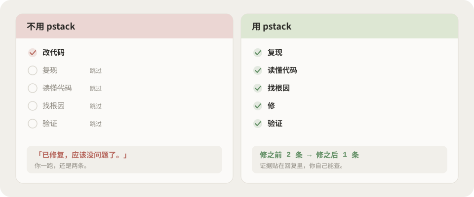
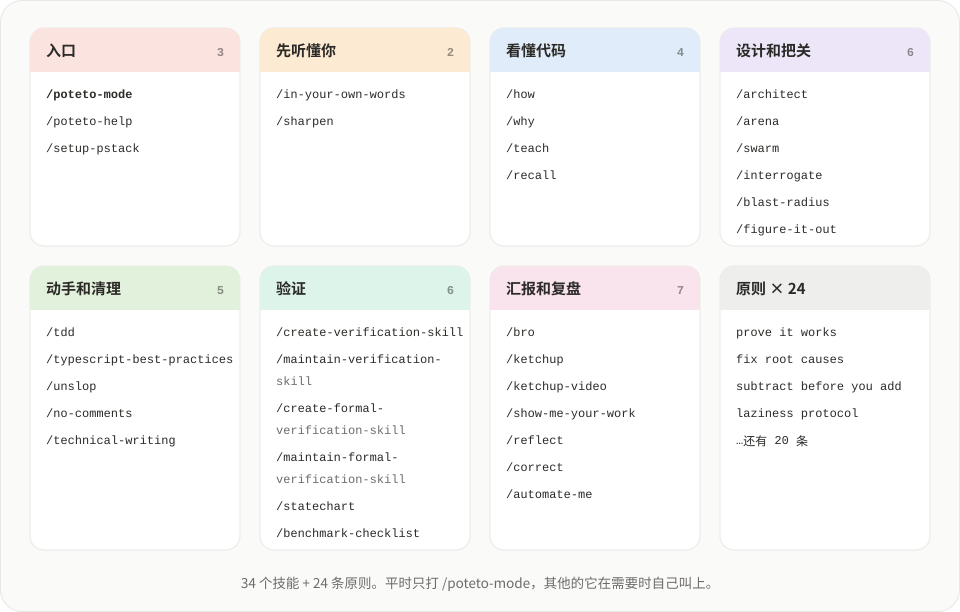
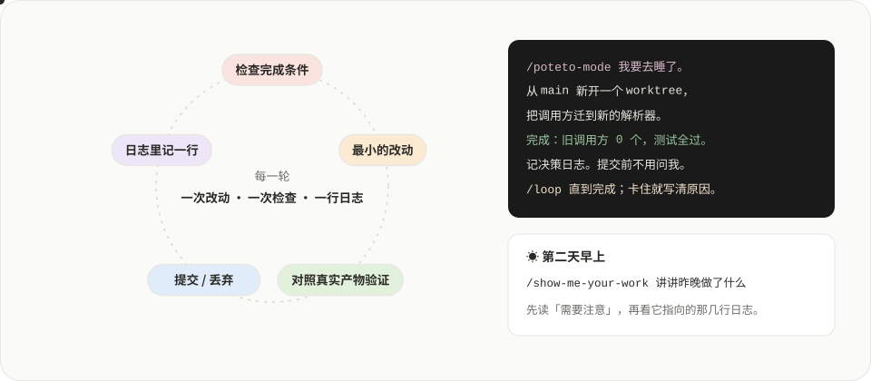

<div align="center">

# pstack 新手教程

**让 AI 写代码像个靠谱的资深工程师：先搞懂，再动手，拿出证据。**

[pstack](https://github.com/backnotprop/pstack) 的中文入门教程。说人话，从装上第一行命令，讲到在真实项目里放手让它跑一夜。

### 👉 [在线阅读：pstack.xiaoxiaodong.ai](https://pstack.xiaoxiaodong.ai)


</div>

<p align="center">
  
</p>

<p align="center">
  <a href="#-为什么需要它">为什么</a> ·
  <a href="#-它是怎么干活的">怎么干活</a> ·
  <a href="#-三分钟上手">上手</a> ·
  <a href="#️-34-个技能一张图">技能地图</a> ·
  <a href="#-在真实项目里">真实项目</a> ·
  <a href="#-放手让它跑一夜">跑一夜</a> ·
  <a href="#-本地运行">本地运行</a> ·
  <a href="https://pstack.xiaoxiaodong.ai">在线阅读</a>
</p>

## 😵 为什么需要它

用 AI 写过代码的人，大概都见过这一幕：它一上来就改，改在看起来合理的地方，然后告诉你「已修复，应该没问题了」。你一跑，还是坏的。

<p align="center">
  
</p>

pstack 是 poteto（React 核心团队成员，在 Cursor 工作）每天自己写代码用的一包 Agent Skills。**模型还是那个模型，变的是做事的顺序和标准：**

| | 平常的 AI | 装了 pstack |
|---|---|---|
| 动手之前 | 直接改 | 先用自己的话复述目标，先用 `/how` 读懂代码 |
| 修 bug | 在表面加个判断 | 先复现，找到**第一个出错的地方**再修 |
| 说「做完了」 | 「应该没问题了」 | 贴出真实的命令输出、存下来的值、前后对比 |
| 代码量 | 越改越多 | 第一条原则：能删就删，用最小的改动解决问题 |
| 并行 | 几个 AI 抢同一个目录 | 各用各的 worktree，放心同时开好几个 |

> [!NOTE]
> pstack 会多派子代理、让几个模型互相挑刺，所以**更慢、更费 token**。这是换来严谨的价格。小改动不用它，怎么省见 [控制花费](https://pstack.xiaoxiaodong.ai/howto/cost/)。

## 🧭 它是怎么干活的

<p align="center">
  
</p>

你只要记一个命令 `/poteto-mode`，说清楚**要什么**和**怎么算做完**。它从 23 套「剧本」里挑一套（修 bug、加功能、重构、查性能……），把步骤抄进待办清单，一步步调用其他技能。决定不做的步骤不会悄悄消失，会写明 `skip: 理由`。

## ⚡ 三分钟上手

**1. 装上**（按你的工具选一种）

```bash
# Claude Code（命令会带 pstack: 前缀，比如 /pstack:poteto-mode）
/plugin marketplace add cursor/plugins
/plugin install pstack@cursor-plugins

# Cursor
/add-plugin pstack

# Codex、OpenCode 等（Node.js 22.20+；加 -g 装到全局）
npx skills add backnotprop/pstack
```

**2. 选模型**：新开对话跑一次 `/setup-pstack`，问到要不要生成「验证技能」时选**要**。

**3. 第一个任务**：挑一件真实但不大的事，像跟同事交代工作一样说：

```text
/poteto-mode 收藏列表刷新后偶尔会重复。先复现，不要先改代码。
修好的标准：连点十次收藏，列表和 chrome.storage 里都只有一条。
把修之前和修之后 storage 里的实际内容给我看。
```

> [!TIP]
> 一句好提示词最多五样东西：**目标**、**怎么算做完**、**想看什么证据**、**你已经知道的**、**真正的约束**。最好别写的两样：具体怎么做，和你猜的原因。详见 [第 3 步](https://pstack.xiaoxiaodong.ai/guide/3-first-task/)。

## 🗺️ 34 个技能，一张图

<p align="center">
  
</p>

平时只打 `/poteto-mode`，其他的它在需要时自己叫上。想点名用某一个、或者看到 AI 提到一个名字想查查，去 [技能速查](https://pstack.xiaoxiaodong.ai/skills/)：每个技能都有一句人话、什么时候用、能照抄的例句、要和谁一起装。

## 🛠 在真实项目里

每篇都有能直接复制的提示词，例子用的是 Chrome 插件、Astro 网站、Cloudflare 会员站这类真实场景。

| 你手上的活 | 看这篇 | 一句话要点 |
|---|---|---|
| 修一个 bug | [先复现，再修，再证明](https://pstack.xiaoxiaodong.ai/howto/fix-bug/) | 「先复现」是约束，不是客气话 |
| 加一个功能 | [不碰坏旧的](https://pstack.xiaoxiaodong.ai/howto/add-feature/) | 说清楚哪些旧行为一个字节都不能变 |
| 重构 | [结构变，行为不变](https://pstack.xiaoxiaodong.ai/howto/refactor/) | 先录下现在的输出，改完证明没变 |
| 嫌它慢 | [拿数字说话](https://pstack.xiaoxiaodong.ai/howto/perf/) | 给一个测量值，不是一个感觉 |
| 接手陌生项目 | [先看懂再动手](https://pstack.xiaoxiaodong.ai/howto/new-codebase/) | 「先别改代码」让它只调查 |
| 提交前心里没底 | [让几个模型挑刺](https://pstack.xiaoxiaodong.ai/howto/review-branch/) | 只留下能跑出失败的问题 |
| 写文档 | [README、PR 说明](https://pstack.xiaoxiaodong.ai/howto/write-docs/) | 给别人用的代码，先写 README |
| 一个大迁移 | [睡前交给它](https://pstack.xiaoxiaodong.ai/howto/big-migration/) | 「做 4 小时」不是完成条件 |

还有 [照抄就能用的提示词](https://pstack.xiaoxiaodong.ai/howto/recipes/)、[跑偏了一句话拉回来](https://pstack.xiaoxiaodong.ai/howto/steer/)、[不知道该用哪个技能](https://pstack.xiaoxiaodong.ai/howto/which-skill/)。

## 🌙 放手让它跑一夜

<p align="center">
  
</p>

前面所有步骤的回报都在这里：一个**能自己验证**的 AI，才是你能放心留下来独自干活的 AI。睡前给它一份「合同」：目标、能判断过或不过的完成条件、一个新的 worktree、决策日志、一个卡住时的逃生口。早上先读 `/show-me-your-work` 回复里的「需要注意」，审决定，不重读整夜。详见 [第 7 步](https://pstack.xiaoxiaodong.ai/guide/7-overnight/)。

## 📚 站里有什么

| 栏目 | 内容 |
|---|---|
| [主线教程](https://pstack.xiaoxiaodong.ai/guide/0-what/) | 9 步，按顺序看：是什么 → 安装 → 选模型 → 第一个任务 → 先看懂 → 设计动手清理 → 验证交付 → 跑一夜 → 变成你自己的 |
| [技能速查](https://pstack.xiaoxiaodong.ai/skills/) | 34 个技能，一个一块 |
| [How-to](https://pstack.xiaoxiaodong.ai/howto/) | 17 篇，一篇只讲一件事 |
| [Wiki](https://pstack.xiaoxiaodong.ai/wiki/) | 21 个概念：一句话 → 打个比方 → 在 pstack 里 → 常见误区；含 24 条原则和 23 套剧本对照表 |
| [常见问题](https://pstack.xiaoxiaodong.ai/faq/) | 要钱吗？必须用 Cursor 吗？会不会乱改我的代码？ |

页面右上角 <kbd>⌘</kbd> <kbd>K</kbd> 全站搜索，正文里**荧光笔**和**粗下划线**标的是重点，带虚线的词悬停就有一句话解释。

## 🧑‍💻 本地运行

```bash
npm install
npm run dev        # http://localhost:4420
npm run build      # 输出到 dist/
npm run release    # 构建并部署到 Cloudflare
```

```text
src/data/nav.js        站点结构：主线、How-to 清单、术语表（唯一来源）
src/data/skills.js     技能速查的数据
src/data/wiki.js       Wiki 条目
src/data/faq.js        常见问题
src/pages/guide/       主线教程（MDX）
src/pages/howto/       How-to（MDX）
public/xxd/            小小东 UI Kit（自带一份，不走 CDN）
tools/build_assets.py  生成 README 里的插画和 SVG 动画
```

改内容、加页面、写作规矩见 [docs/MAINTAINING.md](docs/MAINTAINING.md)。README 里的图都由 `python3 tools/build_assets.py` 生成，改了文字或颜色重跑一次。

## 🙌 致谢

- [pstack](https://github.com/cursor/plugins/tree/main/pstack) 由 [poteto](https://x.com/poteto) 开发；本站用的是 [backnotprop/pstack](https://github.com/backnotprop/pstack) 这个通用镜像。教程内容依据它的 README 和 docs/guide 写成，命令和行为以官方仓库为准。
- 站点骨架来自 [小小东 VPS 教程站](https://vps.xiaoxiaodong.ai)，界面用 [小小东 UI Kit](https://ui.xiaoxiaodong.ai)，插画配色借自 [ghostty-tint](https://github.com/nevertoday/ghostty-tint)。

本站是非官方的中文入门教程。发现哪里没写清楚、照做不成功，欢迎 [提 Issue](https://github.com/nevertoday/xxd-pstack/issues)。

## 📄 License

教程文字和站点代码采用 [MIT](LICENSE)。`public/xxd/` 里的小小东 UI Kit 构建产物不在此列，适用它自己的 [LICENSE](public/xxd/LICENSE)（非商用免费，商用需授权）。

Copyright (c) 2026 [小小东 Xiaoxiaodong](https://x.com/xiaoxiaodong01)
